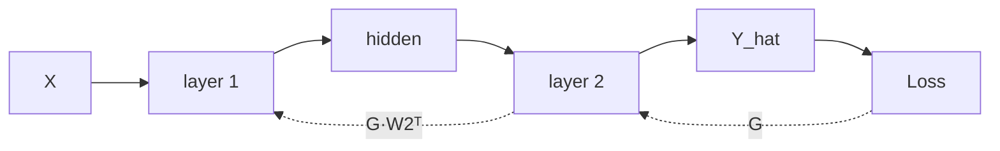

# Tensors and backprop: the general (matrix) form

How a network computes its gradients, written for batches and matrices from the start. The scalar case
`y = a·x + b` is the special case N = D = K = 1. Short definitions are in
[concepts.md](concepts.md#ml-foundations-tier-1-item-2). Code: `ml_foundations/autograd_basics.py` (scalar),
`ml_foundations/linear_backprop.py` (matrix).

## 0. Running example: a DC motor test bench

Each run on the bench measures **D = 3 inputs** (voltage, load torque, temperature) and we want to predict
**K = 2 outputs** (speed, current). We take **N = 8 runs**. This is linear regression with several inputs and outputs:
every output is a weighted sum of the inputs plus an offset, like `y = Cx + Du` in state-space form.

| Symbol | Shape | Meaning in the motor example |
|---|---|---|
| X | (N, D) = (8, 3) | one row per run, one column per measured input |
| W | (D, K) = (3, 2) | one row per input, one column per output: `W[d, k]` = effect of input d on output k |
| b | (K,) = (2,) | one offset per output (speed, current) |
| Y, Ŷ | (N, K) = (8, 2) | true / predicted speed and current for every run |

```
              speed   current
voltage    [  w11      w12  ]
torque     [  w21      w22  ]      ← w22: how load torque affects current
temp       [  w31      w32  ]
```

**How the shapes scale.** Adding a sensor (vibration) gives D = 4: X → (8, 4) and W → (4, 2). b and Ŷ don't change,
because they depend only on the outputs (K) and runs (N). Adding an output (efficiency) gives K = 3, which changes
W, b and Ŷ. Taking more runs changes only N: X and Ŷ grow, and the parameters W and b stay the same size.

## 1. Tensors

A **tensor** is an n-dimensional array with four pieces of metadata:

| Attribute | Example | Why it matters |
|---|---|---|
| `shape` | `(16, 3, 640, 640)` | most bugs are shape bugs |
| `dtype` | `torch.float32` | gradients need floating-point types |
| `device` | `cpu`, `cuda:0` | every tensor in an operation must be on the same device |
| `requires_grad` / `grad_fn` | `True` / `AddBackward0` | whether autograd records operations on it |

**Shape conventions.** The first dimension is the **batch** `N`.

- Tabular data: `X` is `(N, D)`, N samples with D features each.
- Images: `(N, C, H, W)`. My YOLO training batches were `(16, 3, 640, 640)`.

**1-D vs 2-D.** `(K,)` is a vector with one dimension. `(K, 1)` is a matrix with K rows and 1 column. They hold the
same numbers but behave differently in broadcasting and `@`. A bias is `(K,)`.

**The four kinds of operations:**

| Kind | Examples | Shape rule |
|---|---|---|
| Elementwise | `+ - * / **`, `relu` | output shape = input shape (after broadcasting) |
| Matrix product | `X @ W` | `(N, D) @ (D, K) → (N, K)` |
| Reduction | `sum`, `mean`, `max` | `dim=d` removes dimension d; no `dim` → scalar |
| Reshape | `reshape`, `view`, `permute`, `unsqueeze`, `.T` | same data, new shape |

**Broadcasting.** Line the shapes up from the right. Each pair of dimensions must be equal, or one of them must
be 1 or missing. That dimension is then stretched (copied) to match.

```
Y_hat:  (N, K)        X @ W
b:         (K,)       missing dim on the left → treated as (1, K) → copied to N rows
result: (N, K)
```

## 2. One linear layer, forward

$$\hat Y = XW + \mathbf{1}b^\top,\qquad X\in\mathbb R^{N\times D},\; W\in\mathbb R^{D\times K},\; b\in\mathbb R^{K}$$

Mean squared error over the batch (squared norm per sample, then mean over samples):

$$L = \frac{1}{N}\sum_{i=1}^{N}\lVert \hat y_i - y_i\rVert^2$$

The loss is a **scalar**, and that's required: `backward()` starts from one number.

## 3. One linear layer, backward

The gradient that arrives from above is the **upstream gradient** G:

$$G = \frac{\partial L}{\partial \hat Y} = \frac{2}{N}(\hat Y - Y)\qquad (N\times K)$$

From G the layer computes three gradients:

| Gradient | Formula | Shape | Used for |
|---|---|---|---|
| weights | $\partial L/\partial W = X^\top G$ | `(D, K)` | updating W |
| bias | $\partial L/\partial b = \sum_i G_{i,:}$ | `(K,)` | updating b |
| input | $\partial L/\partial X = G\,W^\top$ | `(N, D)` | becomes G for the layer below |

**What G and XᵀG mean in the motor example.** `G[i, k]` is the error signal of run i on output k (positive = the
prediction was too high). One entry of the weight gradient is

$$\frac{\partial L}{\partial W_{dk}} = \sum_{i=1}^{N} X_{id}\,G_{ik}$$

so the gradient for "torque → current" (`W[1, 1]`) adds up, over all runs, *torque in that run × current error in
that run*. A knob is blamed in proportion to how much of its input was present when its output was wrong.
The bias has no input attached (always 1), so its gradient is just the summed error: `G.sum(dim=0)`.

**Rules to remember:**

1. **A gradient always has the same shape as its tensor.** `W.grad.shape == W.shape`. You can use this to recover
   the formulas: the only way to make `(D, K)` from X `(N, D)` and G `(N, K)` is `X.T @ G`.
2. **Broadcast in forward → sum in backward.** In the forward pass, b was copied to all N rows, so each row's
   gradient flows back into the same b. Those contributions add up, so `db = G.sum(dim=0)`: sum over the
   dimension that was broadcast (the batch).
3. **The input gradient is what makes depth possible.** For data, `∂L/∂X` is useless (we don't update data). In a
   deep network, though, X of layer 2 is the output of layer 1, so `G W^T` becomes layer 1's G.



## 4. Why PyTorch never builds Jacobians

The full Jacobian of $\hat Y$ with respect to W would have `(N·K) × (D·K)` entries. Each operation instead implements a
**vector–Jacobian product (VJP)**: it receives G and returns the product directly (`X.T @ G`), without ever forming
the Jacobian. That's also why `backward()` needs a scalar loss: the first G is then just `1`.

## 5. Autograd mechanics

| Concept | What PyTorch does |
|---|---|
| `requires_grad=True` | marks a tensor as a parameter; operations on it are recorded |
| computational graph | built **during the forward pass**, rebuilt every iteration |
| `grad_fn` | each result remembers the operation that made it (`PowBackward0`, `MmBackward0`, ...) |
| `loss.backward()` | walks the graph in reverse, chaining VJPs |
| `.grad` | where each parameter's gradient lands; same shape as the parameter |
| accumulation | `backward()` **adds** into `.grad` → call `zero_grad()` every iteration |
| graph freed | after `backward()` the graph and saved intermediates are deleted to free memory |
| `torch.no_grad()` | turns off recording: used for the update step and for evaluation |

**Memory cost of training.** The backward pass needs the forward values (X to compute `XᵀG`, W to compute `GWᵀ`),
so every intermediate activation is kept until `backward()` runs. That's why training uses far more GPU memory
than inference.

## 6. The learning rate as a pole

Stack all knobs in one vector θ (W and b) and append a column of ones to X: A = [X, 1], shape (N, D+1). One
gradient-descent step on the MSE loss is a **linear discrete-time system** in the knob error e = θ − θ*:

$$e_{k+1} = \Big(I - \tfrac{2\,\text{lr}}{N}A^\top A\Big)\,e_k \qquad\Rightarrow\qquad p_j = 1 - 2\,\text{lr}\,\lambda_j$$

where λⱼ are the eigenvalues of AᵀA/N (the curvature of the loss bowl). Stable when every |pⱼ| < 1:

$$\text{lr} < \frac{1}{\lambda_{\max}}$$

Motor bench (seed 0): λ ∈ [0.82, 1.21] → limit lr ≈ 0.83. My sweep (100 steps):

| lr | slowest pole | loss at step 90 | behavior |
|---|---|---|---|
| 0.01 | +0.98 | 70 058 | stable, very slow |
| 0.1 | +0.84 | 434.01 | smooth, flat by step ~30 |
| 0.5 | ≈ ±0.2 | 434.01 | near deadbeat, flat by step 10 |
| 0.8 | −0.94 | 442.39 | overshoots every step (negative pole), slow decay |
| 0.9 | −1.18 | → inf | unstable |

**Takeaways.**
- Bigger isn't faster past a point: a negative pole near −1 oscillates and decays slowly.
- The **data sets the limit** through λ. Raw sensor units (volts, °C) make λ large and force a tiny lr, which is why
  inputs are normalized.
- Deep nets aren't perfect bowls and λ is unknown, so lr is found by a **sweep**. `nan`/`inf` loss → suspect lr first.
- Open question: HIDAS used lr = 1e-1 for PPO (typical ≈ 3e-4). Revisit in the RL track.

## 7. Checks from my runs

| Script | Result |
|---|---|
| `autograd_basics.py` (scalar, x=2, y=7, a=1, b=0) | loss 25; grads (−20, −10); without zeroing → (−40, −20); update with lr 0.01 → a=1.4, b=0.2 |
| `linear_backprop.py` (N=8, D=3, K=2) | shapes (8,2) (3,2) (2,); autograd grads match `XᵀG` and `ΣG` (W ok: True, b ok: True) |
| `motor_regression.py` (N=200, lr 0.1, 100 steps, knobs start at 0) | loss 2.33 M → 434 (flat from step ~50; floor ≈ noise power 20² + 0.1² ≈ 400). Learned W ≈ [[299.9, 0.196], [−151.1, 2.012], [−9.7, 0.086]] vs true [[300, 0.2], [−150, 2.0], [−10, 0.1]]; b ≈ (1499.1, 3.005) vs (1500, 3.0) |
